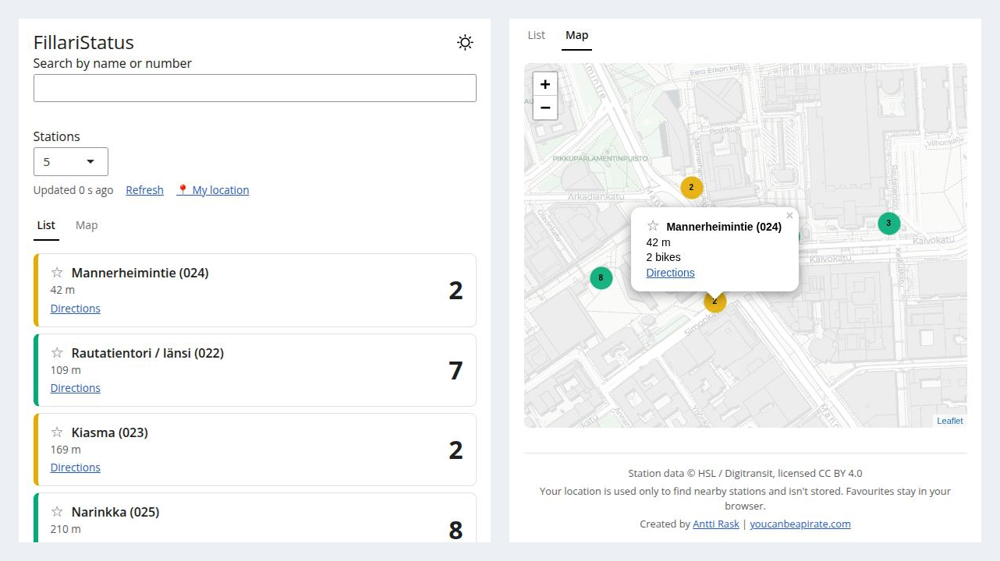

# 🚲 FillariStatus

**FillariStatus** is a small web app that answers one question fast: *are there city bikes near me right now?* It lists the nearest Helsinki and Espoo city bike stations with live bike counts, on a list or a map.

## 🔍 Features

- 📍 **Nearest stations** from your browser's location: the 5 closest by default, adjustable from 1 to 20
- 🚲 **Live bike counts**, colour-coded (empty / low / plenty) and always shown as a number too, so colour is never the only cue
- 🗺️ **Map view** with the bike count printed on every marker, popups, and a "you are here" target
- 🔍 **Search** by station name or number; it overrides the location-based list and clearing it brings the list back
- ⭐ **Favourites**, pinned to the top; stored in your own browser, no account needed
- 🧭 **Get directions** - one tap to Google Maps (walking)
- 🌗 **Light by default** with a dark mode toggle, mobile-first layout, youcanbeapirate colours
- 🔄 **Auto-refresh** every minute, with an "Updated 6 min ago" stamp
- 🧯 **Graceful states**: a friendly message when the bike season is over, old data kept on screen (with a warning) when a refresh fails, and a search fallback when location is denied

## 📸 Screenshot



## 🚀 Live App

👉 [Try it here!](https://fillaristatus.youcanbeapirate.com)

📄 [Project page](https://youcanbeapirate.com/FillariStatus/)

## 🛠️ How it works

```
Browser ──(location, favourites, search)──▶ Shiny server (Google Cloud Run)
                                             │
                                             ├─ get_stations()  ← cached 60 s, shared by all visitors
                                             │     └─ HSL / Digitransit GraphQL API (key stays on the server)
                                             │
                                             └─ per visitor: filter, distance, sort, render list + map
```

- One cached upstream call per minute serves every visitor, so the app is gentle on the Digitransit API.
- If a refresh fails, the last good data stays on screen with a warning instead of an error.
- The page is served with browser-protection headers (clickjacking, referrer, permissions, HSTS and a report-only content security policy), set in `app/www/security.R`.
- There is no database and no accounts. Favourites live in your browser's `localStorage`; your location is used in memory to find nearby stations and is not stored.

## 📁 Project Structure

```bash
app/
├── run.R             # entry point: sets the working dir, wraps the page handler with the security headers (PORT env var)
├── global.R          # libraries, config
├── ui.R              # layout: controls, List/Map tabs, footer
├── server.R          # reactive logic, list rendering, map via leafletProxy
└── www/
    ├── api.R         # Digitransit query, parsing, cached get_stations() with stale fallback
    ├── security.R    # security headers, wrapped around the page handler in run.R
    ├── functions.R   # distances, status colours, nearest/search logic, formatting, popup + icon helpers
    ├── variables.R   # thresholds, status + brand palettes, map settings, links
    ├── strings.R     # all user-facing text (one place, ready for translation)
    ├── geolocation.js, favourites.js, styles.css, favicon.*
tests/testthat/       # unit and server tests against a saved real API response
docs/                 # the project page (GitHub Pages: main branch, /docs folder)
.github/              # deploy workflow (Cloud Run) and Dependabot config
Dockerfile, docker-compose.yml, deploy.sh, DEPLOY.md
fillaristatus-plan.md # project plan and history; CLAUDE.md has guidance for Claude Code
```

## 💻 Run Locally

You need a free [Digitransit API key](https://portal-api.digitransit.fi/). Put it in a git-ignored `.Renviron` in the project root (the map tiles need no key):

```
DIGITRANSIT_SUBSCRIPTION_KEY=...
```

Then either:

```r
renv::restore()
```

```bash
PORT=8083 Rscript app/run.R   # same entry point as production, including the security headers
```

or, with Docker (the same image Cloud Run uses):

```bash
docker compose up --build
```

and open http://localhost:8083. Browsers only allow geolocation on `localhost` or HTTPS.

## ✅ Tests

```r
testthat::test_dir("tests/testthat")
```

About 220 expectations covering the data layer, the logic, the server and the security headers. They use a saved real API response, so they never call the live API.

## ☁️ Deployment

The app runs on Google Cloud Run. A push to `main` that changes the app or its build files deploys automatically through GitHub Actions (build, deploy, smoke test); docs-only pushes don't. See [DEPLOY.md](DEPLOY.md) for the secret, `deploy.sh`, the workflow and the custom-domain steps.

## 📊 Data

Station data © [HSL](https://www.hsl.fi/) / [Digitransit](https://digitransit.fi/), licensed [CC BY 4.0](https://creativecommons.org/licenses/by/4.0/). Map tiles © Esri — Esri, HERE, Garmin, © [OpenStreetMap](https://www.openstreetmap.org/copyright) contributors, and the GIS user community.

## 📄 License

- [MIT](LICENSE)

## 👤 Author

Created by [Antti Rask](https://www.linkedin.com/in/AnttiRask/) · [youcanbeapirate.com](https://youcanbeapirate.com)
